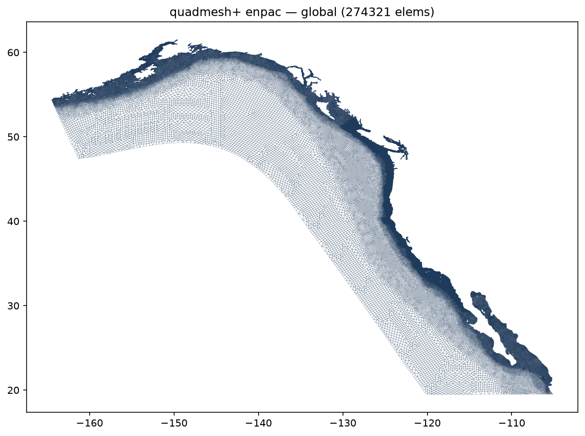
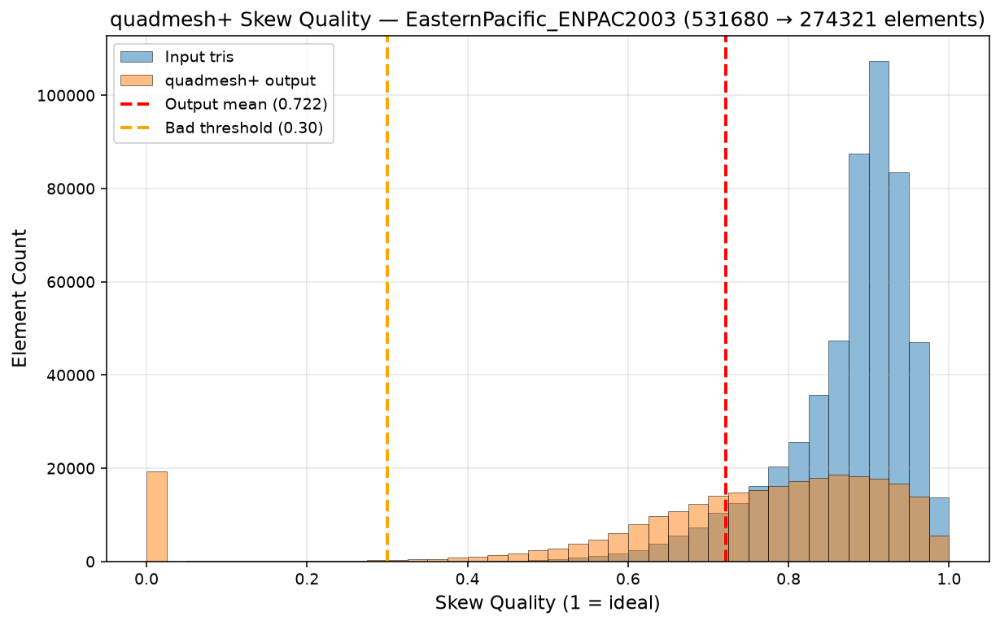
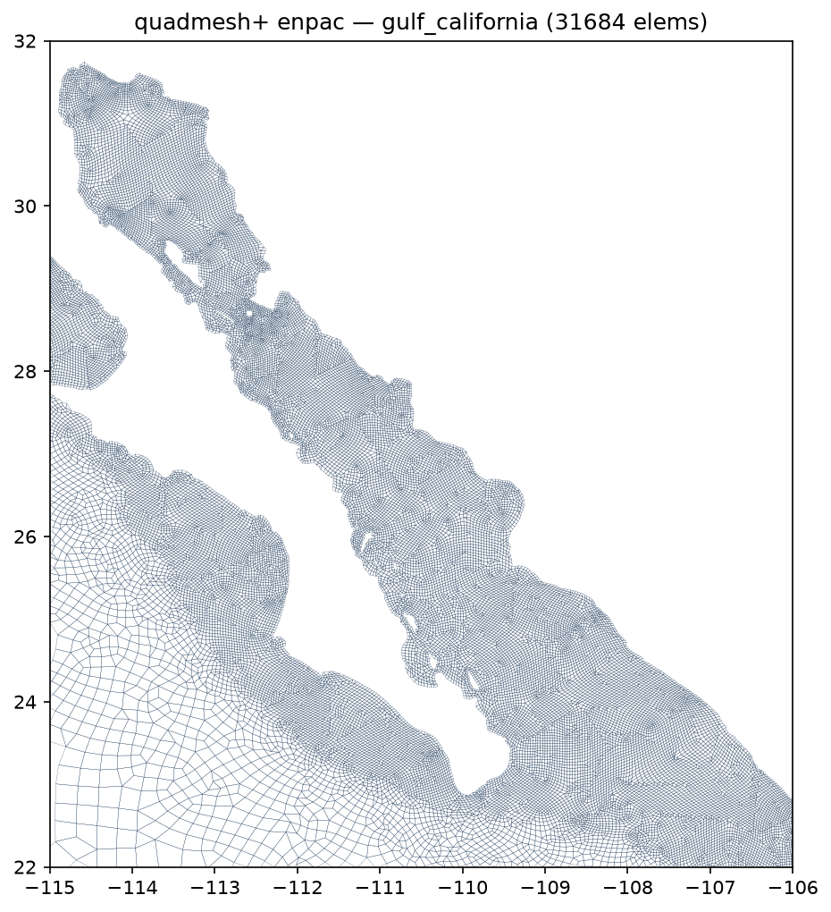

# Performance and benchmarks

On the largest mesh available through Valence, `ENPAC2003` (the Eastern North Pacific tidal grid of **531,680 triangles across 272,913 nodes**), QuADMESH+ returns a fully quadrilateral mesh of **274,321 quadrilaterals with zero interior residual triangles** (the faithfulness invariant) in **773 s (12.9 min)**, single-threaded, on the `chilmesh` 1.0.0 backend.

<p align="center">
  
</p>

### Phase timing

Single run, single thread, measured at QuADMESH 0.1.0 with the `chilmesh` 1.0.0 backend. The post-process stage (doublet collapse, boundary cleanup, and the FEM smoother) dominates the wall-clock budget; the layer-ordered tri-to-quad sweep is the second cost.

| Phase | Time (s) | Share |
|---|---|---|
| Load + half-edge initialization | 33.9 | 4.4% |
| `create_quad_domain` | 15.0 | 1.9% |
| `tri2quad_routine` (layer-ordered sweep) | 186.8 | 24.2% |
| `post_process_routine` (collapse + cleanup + FEM smooth) | 537.6 | 69.5% |
| **Total** | **773.3** | **100%** |

> Note: this breakdown predates the `fem_smoother` short-circuit (#107). The `method="fem"` smoothing path is a connectivity-anchored equilibrium solve. One pass reaches equilibrium, so the smoother returns after one pass. The 69.5% post-process share above overstates the current cost. A separate benchmark on the 246k-triangle `WNAT_Onur` mesh puts smoothing at about 12% of wall-clock. The next release benchmark re-measures `ENPAC2003`.

### Element quality

Skew quality on the unit interval (1 = an ideal square; the `chilmesh` `element_quality(metric="skew")` metric), reported before (input triangles) and after (output quadrilaterals).

<p align="center">
  
</p>

| Metric | Input triangles | Output quads |
|---|---|---|
| Mean | 0.875 | 0.722 |
| Median | 0.897 | 0.783 |
| Minimum | 0.150 | 0.000 |
| Std. dev. | 0.081 | 0.241 |
| Fraction below 0.30 | 0.0% | 7.6% |

Recombining two triangles into one quadrilateral trades a measurable amount of per-element quality (mean skew 0.875 → 0.722) for the element-count halving and the all-quad topology. The sub-0.30 tail is **7.6%** of elements and is almost entirely a boundary-layer artifact: skeletonization layer 0 (the boundary band) carries 20,888 of the 20,918 low-quality quads at a 20.5% bad-rate and a mean skew of 0.552, while every interior layer (1 and inward) holds at mean skew ≥ 0.80, rising monotonically to 0.967 at the innermost layer. Of the low-quality quads, 93.0% touch the domain boundary along **two or more edges**. These are the near-degenerate boundary-following quads that the FEM smoother cannot relax because their nodes are pinned to the boundary. The Gulf of California subset below shows the regular interior quads against this thin boundary band:

<p align="center">
  <br>
  <em>QuADMESH+ output over the Gulf of California (subset of the ENPAC2003 domain).</em>
</p>

The boundary-layer quality limitation is tracked in [#90](https://github.com/domattioli/QuADMESH/issues/90); both measurements above are reproducible from the repository:

```bash
# per-phase timing + quality histogram for any fort.14 mesh
python scripts/bench_quadmesh_plus.py --mesh path/to/mesh.14

# classify low-quality quads by mesh layer and boundary contact
python scripts/diagnose_bad_quads.py --mesh path/to/mesh.14 --tag mymesh
```

---

## Benchmark

`quadmesh-bench` runs several triangle-to-quad methods on the same mesh and prints one table per mesh. Each row reports element count, quad fraction, residual triangles (interior and boundary), skew mean, min and standard deviation, runtime, and boundary-vertex changes. A method that fails or is absent gets a row with its status; the run continues.

Adapters with a measured row in [`0.3.0/results.md`](0.3.0/results.md): QuADMESH+. On the four bundled meshes, QuADMESH+ leaves no residual triangles and has skew min 0.000. Its default point insertion adds boundary vertices; the table reports boundary vertices lost (input boundary vertices with no match in the output) and added (new output boundary vertices).

Available adapters without a measured row: Gmsh Blossom-Quad and QuadriFlow, each marked "requires user-installed tool". Both run as subprocesses of an executable you install. Nothing from either tool ships in this package, and neither was present when the table was produced. QuadriFlow remeshes from a cross field and may move or drop boundary vertices. Its Python route (`pyquadriflow`, installed by `quadmesh[bench-quadriflow]` on Linux and Windows only) is pre-alpha and unverified here.

```bash
quadmesh-bench --list                                  # adapters and install routes
quadmesh-bench --bundled --out docs/benchmarks/0.3.0   # reproduce the table
quadmesh-bench mesh.14 --disable gmsh-blossom          # skip an adapter
```

Set `QUADMESH_BENCH_DISABLE=name1,name2` to disable adapters for every run. `--strict` returns a non-zero exit code when any row is not `ok`.
